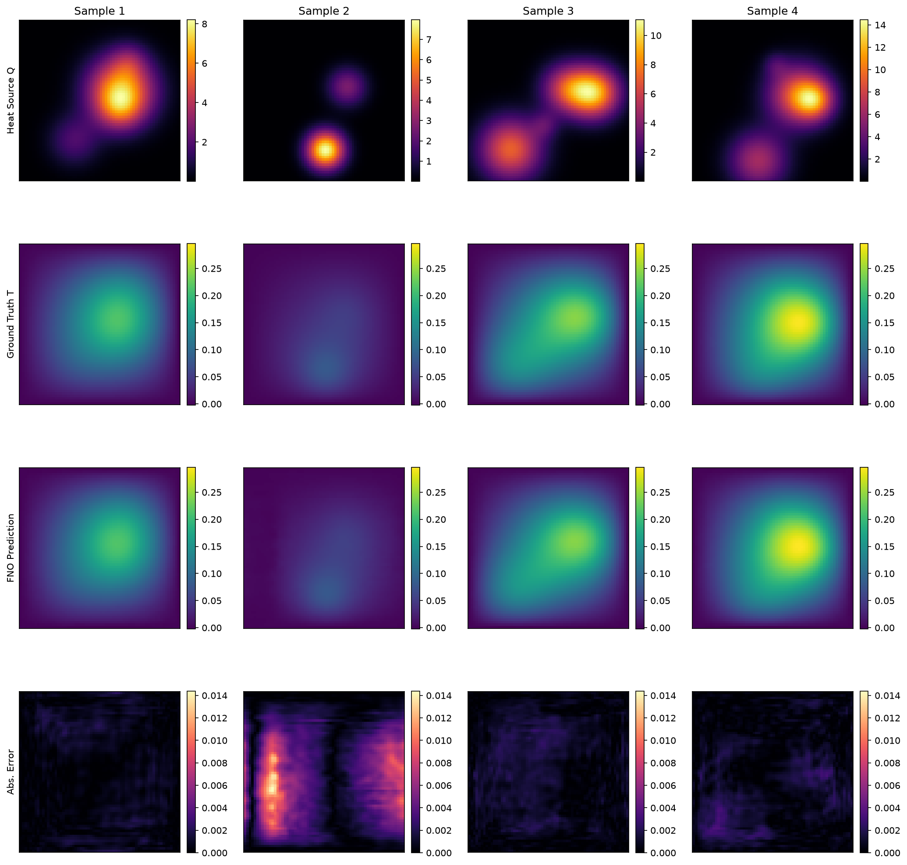

# Thermal Surrogate ML

A Fourier Neural Operator (FNO-2D) surrogate that replaces an explicit finite-difference solver for the 2D transient heat equation, delivering two-orders-of-magnitude faster inference and zero-shot super-resolution from 64x64 training grids to 128x128 evaluation grids.

---

## 1. Problem formulation

### Governing equation

The ground-truth physics is the 2D transient heat (diffusion) equation with a volumetric source term:

$$
\frac{\partial T}{\partial t} = \alpha \nabla^2 T + Q(x, y, t), \qquad (x, y) \in [0, L]^2
$$

with thermal diffusivity `alpha = 1.0` and domain side `L = 1.0`. The source `Q` is a superposition of 1-4 Gaussian heat spots, modelling localized heat-generating components (e.g. chips on a substrate):

$$
Q(x, y) = \sum_{k} A_k \exp\!\left(-\frac{(x - x_k)^2 + (y - y_k)^2}{2\sigma_k^2}\right)
$$

Sampling ranges for the parametric family: centers `x_k, y_k ~ U(0.1L, 0.9L)`, amplitudes `A_k ~ U(1, 10)`, widths `sigma_k ~ U(0.05, 0.15)`.

### Boundary and initial conditions

- **Dirichlet** (`T = 0`) on all four edges is the default and the configuration used for every dataset, checkpoint and benchmark in this repository. A zero-flux **Neumann** variant is implemented via edge-padded ghost cells and is selectable through `HeatSolverConfig`.
- The initial condition is `T(x, y, 0) = 0` for the shipped datasets; a smooth localized Gaussian initial field is available through `randomize_initial=True`.

### Classical numerical solver (ground truth)

[`HeatSolver`](src/thermal_surrogate_ml/physics/heat_solver.py:96) is an explicit Euler integrator on a uniform `N x N` grid:

- **Spatial discretization:** second-order 5-point Laplacian stencil on interior nodes; Dirichlet values are re-imposed on the boundary after every update.
- **Time stepping:** `dt = cfl_factor * dx^2 / alpha` with `cfl_factor = 0.2`, safely below the 2D von Neumann stability bound of `0.25`. The constructor rejects any configuration where `alpha * dt / dx^2 > 0.25`.
- **Resolution:** `N = 64`, `dx = 1/63`, hence `dt ~ 5.04e-5` and ~1984 steps to reach `t_final = 0.1`.
- **Steady state:** [`solve_steady_state()`](src/thermal_surrogate_ml/physics/heat_solver.py:300) iterates until `max|T_new - T_old| < 1e-8`, capped at `20 * (N - 1)^2` steps. This is the routine timed in the benchmark.

The solver is pure NumPy and deliberately free of PyTorch, so the physics and ML pipelines remain decoupled.

### Dataset

[`generate_dataset()`](src/thermal_surrogate_ml/data/generate.py:81) writes compressed `.npz` splits containing `source` (`Q`), `initial` (`T_0`) and `target` (`T` at `t_final`), each `float32` of shape `[N, 64, 64]`. Defaults are 500 / 100 / 100 train / validation / test scenarios, with independent RNG seeds (`seed`, `seed + 1`, `seed + 2`) to prevent split leakage. The surrogate consumes `Q` as a single-channel `[1, 1, 64, 64]` tensor and predicts `T`; normalization is z-score, fitted on the training split and persisted inside the checkpoint so validation, test and benchmark inputs are transformed identically.

---

## 2. FNO-2D architecture

[`FNO2d`](src/thermal_surrogate_ml/models/fno.py:82) learns the solution operator `Q -> T` as a field-to-field map on channels-first tensors `[B, C, H, W]`. The shipped checkpoint uses `modes1 = modes2 = 12`, `width = 32`, `n_layers = 4`, `in_channels = out_channels = 1` (1,188,289 parameters).

### Lifting

A pointwise linear layer `fc0: 1 -> 32` lifts the scalar source field into a 32-channel latent representation. The tensor is transposed to `[B, H, W, C]` around the layer so the linear map acts over channels only, never mixing spatial positions.

### Spectral convolution blocks

Each of the four blocks is

```
x <- GELU( SpectralConv2d(x) + Conv2d_1x1(x) )
```

[`SpectralConv2d`](src/thermal_surrogate_ml/models/fno.py:25) performs the global operation in the Fourier domain:

1. `rfft2` over the spatial axes.
2. A complex `einsum` contraction of the lowest `12 x 12` modes with learned complex weights, applied to both the positive-mode block and the negative-mode block along the first axis (the second axis is Hermitian-symmetric under `rfft`).
3. All higher modes are left at zero.
4. `irfft2(..., s=(H, W))` returns to physical space at the requested resolution.

The parallel `1x1` convolution is a pointwise bypass that preserves local, high-frequency information the truncated spectral path discards.

### Projection

`fc1: 32 -> 128`, GELU, `fc2: 128 -> 1`, applied channel-wise, projects the latent field back to a scalar temperature field.

### Why the Fourier parameterization is resolution-invariant

The learned parameters are indexed by **mode number**, not by grid point: `weights1` and `weights2` are tensors of shape `[in, out, 12, 12]`, independent of `H` and `W`. The network therefore approximates a truncated Fourier multiplier of the continuous operator, and the only resolution-dependent step is the final `irfft2` with an explicit output size `s=(H, W)`. Evaluating the same weights on a `128 x 128` grid re-samples the same spectral representation on a finer lattice rather than interpolating a coarse output.

This is the mechanism behind **zero-shot super-resolution**: the model is trained exclusively on `64 x 64` data, yet [`benchmark.py`](src/thermal_surrogate_ml/training/benchmark.py:190) feeds it a `128 x 128` source and asserts the output shape `(1, 1, 128, 128)` without any retraining or fine-tuning. The truncation at 12 modes also acts as a spectral prior: the solution operator of a linear parabolic PDE driven by smooth Gaussian sources is dominated by low-frequency content, so the discarded modes carry little energy.

---

## 3. Benchmark results

### Methodology

[`benchmark.py`](src/thermal_surrogate_ml/training/benchmark.py:130) measures wall-clock latency for a single random Gaussian source drawn from the training distribution:

- **Solver baseline:** `HeatSolver.solve_steady_state()` on a `64 x 64` grid, `tol = 1e-8`, one warm-up call followed by `--runs` timed calls, averaged with `time.perf_counter()`.
- **FNO:** forward pass under `torch.no_grad()` in `eval()` mode, three warm-up passes, then `--runs` timed passes. CUDA latency is measured with `torch.cuda.Event` and a device synchronize (kernels are asynchronous); CPU latency uses `perf_counter`.
- **Speedup factor:** solver latency divided by FNO latency, both relative to the `64 x 64` solver baseline.
- **Zero-shot case:** the `128 x 128` FNO latency is measured on a `128 x 128` source; no `128 x 128` numerical solve is timed, so the reported factor is a conservative comparison against the cheaper `64 x 64` solver.

### Measured results

Command: `uv run python -m thermal_surrogate_ml.training.benchmark --runs 10`
Environment: Windows 11, Python 3.13, PyTorch 2.14.0+cu126, NVIDIA GeForce RTX 4060 Laptop GPU (solver on CPU, FNO on CUDA).

| Grid Resolution | Method | Latency (ms) | Speedup Factor |
|----------------:|:-------|-------------:|---------------:|
| 64x64 | Numerical solver (`HeatSolver`, steady state) | 274.241 | 1.00x |
| 64x64 | FNO (trained on 64x64) | 3.654 | 75.1x |
| 128x128 | FNO (zero-shot, no retraining) | 4.476 | 61.3x |

The surrogate is roughly **two orders of magnitude** faster than the classical solver: 75x at the training resolution and 61x at double the resolution, where the solver's cost would grow by a further factor of ~4 in grid points and ~4 in time steps. The exact factor is hardware- and run-dependent; the figures above are a single measured run of the shipped benchmark, not a hardcoded constant.

### Accuracy

[`evaluate.py`](src/thermal_surrogate_ml/training/evaluate.py:111) reports test-set RMSE and relative L2 in physical units and writes the comparison grid to `results.png`. The recorded artifact shows, for four held-out samples, the source `Q`, the solver ground truth, the FNO prediction and the absolute error. The error panels are bounded by ~1.4e-2 against peak temperatures of ~0.25-0.28, i.e. a few percent of the field maximum; the largest absolute residuals occur in the sample with the weakest source, where the field magnitude is small and the relative error is correspondingly higher. Scalar test metrics are printed by the evaluation script rather than stored in the repository, so they are reproduced by running it (Section 4) rather than quoted here.



---

## 4. Reproduction

### Prerequisites

- Python >= 3.13 and [`uv`](https://docs.astral.sh/uv/).
- PyTorch is resolved from the `pytorch-cu126` index declared in [`pyproject.toml`](pyproject.toml:32); a CUDA 12.6-capable driver is required for GPU execution. The code falls back to CPU automatically via `get_device()`.

### Steps

```bash
cd thermal-surrogate-ml
uv sync
```

1. **Generate the dataset** (writes `data/{train,val,test}.npz`):

```bash
uv run python -m thermal_surrogate_ml.data.generate \
  --n-train 500 --n-val 100 --n-test 100 \
  --grid-size 64 --mode transient --t-final 0.1 --seed 0
```

2. **Train the surrogate** (writes `checkpoints/best_model.pt`, keeping the best validation loss):

```bash
uv run python -m thermal_surrogate_ml.training.train \
  --epochs 300 --batch-size 32 --lr 1e-3 --scheduler cosine
```

3. **Evaluate on the test split** (prints RMSE and relative L2, writes `results.png`):

```bash
uv run python -m thermal_surrogate_ml.training.evaluate \
  --checkpoint checkpoints/best_model.pt --data-dir data --save-path results.png
```

4. **Benchmark against the solver** (prints the latency table and asserts the zero-shot `128 x 128` output shape):

```bash
uv run python -m thermal_surrogate_ml.training.benchmark \
  --checkpoint checkpoints/best_model.pt --runs 10
```

5. **Run the test suite and linter:**

```bash
uv run pytest
uv run ruff check
```

`pyproject.toml` declares a single console script (`thermal-surrogate-ml`, a placeholder entry point), so the pipeline stages are invoked as modules with `python -m` as shown above. `pytest` is configured with `testpaths = ["tests"]` and `pythonpath = ["src"]`, so no installation step beyond `uv sync` is needed.

---

## 5. Repository layout

```
thermal-surrogate-ml/
├── src/thermal_surrogate_ml/
│   ├── physics/heat_solver.py      # explicit FD solver, BCs, Gaussian sources
│   ├── data/generate.py            # parametric dataset generation
│   ├── data/dataset.py             # torch Dataset + normalization statistics
│   ├── models/fno.py               # SpectralConv2d and FNO2d
│   └── training/
│       ├── train.py                # training loop, checkpointing
│       ├── evaluate.py             # test metrics and comparison grid
│       └── benchmark.py            # solver-vs-FNO latency and zero-shot check
├── tests/                          # pytest suite for solver, data, model, training
├── checkpoints/best_model.pt       # trained weights + normalization stats
└── results.png                     # qualitative accuracy artifact
```
